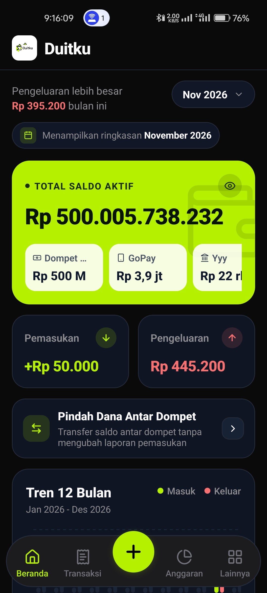
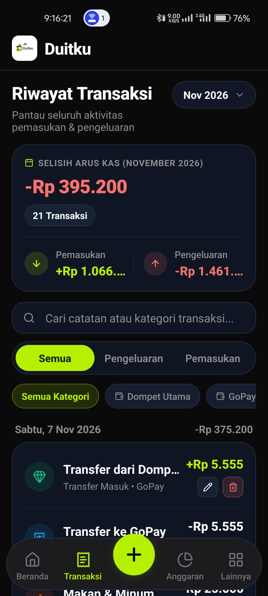
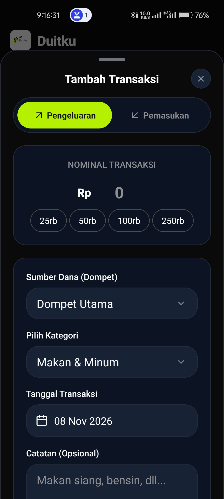
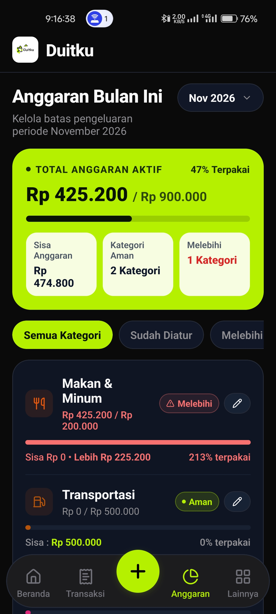
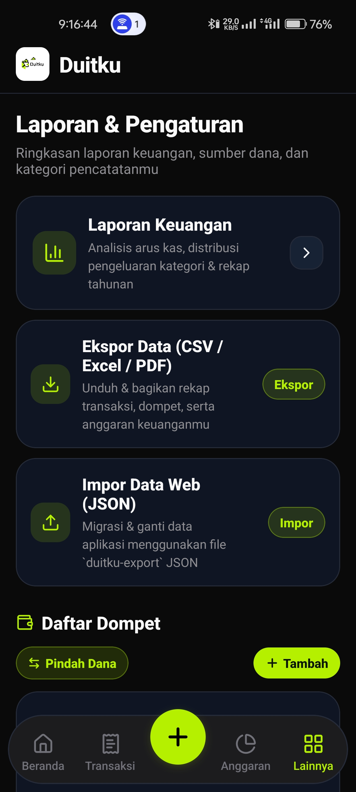

<div align="center">


# Duitku — Pencatat Keuangan Pribadi

Aplikasi mobile **offline-first** untuk mencatat pemasukan, pengeluaran, anggaran bulanan, dan saldo multi-dompet. Dibangun dengan **Expo (React Native)** dan **SQLite**.


</div>

---

## 📸 Screenshot

<table>
  <tr>
    <td align="center"><br/><b>Beranda</b></td>
    <td align="center"><br/><b>Riwayat Transaksi</b></td>
    <td align="center"><br/><b>Tambah Transaksi</b></td>
  </tr>
  <tr>
    <td align="center"><br/><b>Anggaran Bulanan</b></td>
    <td align="center"><br/><b>Laporan &amp; Pengaturan</b></td>
    <td></td>
  </tr>
</table>

## ✨ Fitur

- **Beranda ringkas** — total saldo aktif, saldo per dompet, pemasukan vs pengeluaran, tren 12 bulan, anggaran, dan transaksi terbaru per bulan.
- **Catat transaksi** — pemasukan/pengeluaran dengan nominal cepat (25rb, 50rb, …), pilihan dompet, kategori, tanggal, dan catatan. Mendukung **edit** dan **hapus** transaksi.
- **Riwayat transaksi** — dikelompokkan per tanggal, dengan pencarian serta filter jenis, kategori, dan dompet.
- **Anggaran bulanan** — atur batas per kategori, lihat persentase terpakai, **sisa anggaran**, serta status *Aman* / *Melebihi*.
- **Multi-dompet** — kelola dompet (tunai, bank, e-wallet) dan **pindah dana antar dompet** (dengan biaya admin opsional) tanpa memengaruhi laporan pemasukan/pengeluaran.
- **Laporan keuangan** — analisis arus kas, distribusi pengeluaran per kategori, dan rekap tahunan.
- **Ekspor data** — CSV, Excel (`.xls`), dan PDF untuk bulan terpilih, satu tahun, atau semua waktu.
- **Impor dari versi web** — migrasi data dari Duitku Web melalui file JSON `duitku-export`.
- **Offline-first** — seluruh data tersimpan lokal di perangkat menggunakan SQLite.
- **Tema terang & gelap** otomatis mengikuti sistem.

## 🧱 Tech Stack

| Kebutuhan | Library |
| --- | --- |
| Framework | [Expo SDK 58](https://docs.expo.dev/) + React Native 0.88 |
| Navigasi | [Expo Router](https://docs.expo.dev/router/introduction/) (file-based) |
| Database | [expo-sqlite](https://docs.expo.dev/versions/latest/sdk/sqlite/) + [Drizzle ORM](https://orm.drizzle.team/) |
| Data fetching / cache | [TanStack Query](https://tanstack.com/query) |
| Grafik | react-native-gifted-charts |
| Ikon | lucide-react-native |
| Ekspor & berbagi | expo-print, expo-file-system, expo-sharing |

## 📁 Struktur Proyek

```
src/
├── app/                 # Route Expo Router (setiap file = layar)
│   ├── (tabs)/          # Beranda, Transaksi, Anggaran, Lainnya
│   ├── addTransactionModal.tsx
│   └── financialReport.tsx
├── components/          # Komponen UI per fitur (home, transaction, budget, more, ui)
├── context/             # React Context (modal transaksi)
├── constants/           # Warna & tema
├── db/                  # Klien SQLite, skema Drizzle, migrasi
├── lib/                 # Helper (format Rupiah, dll.)
└── services/            # Query & hooks: wallets, categories, transactions,
                         # budgets, reports, export, import
```

## 🚀 Menjalankan Secara Lokal

### Prasyarat

- [Node.js](https://nodejs.org/) LTS
- [Bun](https://bun.sh/) (proyek ini menggunakan `bun.lock`)
- Aplikasi **Expo Go** di ponsel, atau emulator Android / simulator iOS

### Langkah

```bash
# 1. Clone repository
git clone https://github.com/Onlyadmirer/duitku-mobile-v2.git
cd duitku-mobile-v2

# 2. Install dependencies
bun install

# 3. Jalankan dev server
bunx expo start
```

Pindai QR code dengan Expo Go (Android) atau aplikasi Kamera (iOS), atau tekan `a` / `i` untuk membuka emulator.

### Perintah Lain

```bash
bunx expo lint          # lint
bunx tsc --noEmit       # typecheck
bunx expo-doctor        # cek konfigurasi & dependency
bunx drizzle-kit generate  # generate migrasi setelah mengubah skema
```

## 📦 Build

Gunakan [EAS Build](https://docs.expo.dev/build/introduction/) untuk membuat APK/AAB atau IPA:

```bash
bunx eas-cli build --platform android --profile preview
```

## 🔄 Migrasi dari Duitku Web

Buka **Lainnya → Impor Data Web (JSON)**, lalu pilih file atau tempel isi JSON berformat berikut:

```json
{
  "format": "duitku-export",
  "version": 1,
  "exportedAt": "2026-10-21T08:30:00.000Z",
  "currency": "IDR",
  "data": {
    "wallets": [],
    "categories": [],
    "transactions": [],
    "budgets": []
  }
}
```

> [!WARNING]
> Proses impor akan **mengganti seluruh data** yang ada di aplikasi mobile. Ekspor data terlebih dahulu jika ingin menyimpan cadangan.

## 🤝 Kontribusi

Kontribusi sangat terbuka! Silakan buka *issue* untuk melaporkan bug atau mengusulkan fitur, lalu kirim *pull request*:

1. Fork repository ini
2. Buat branch fitur: `git checkout -b feat/nama-fitur`
3. Commit perubahan: `git commit -m "feat: deskripsi singkat"`
4. Push ke branch: `git push origin feat/nama-fitur`
5. Buka Pull Request

## 📄 Lisensi

Didistribusikan di bawah lisensi MIT. Lihat [LICENSE](./LICENSE) untuk detail.
